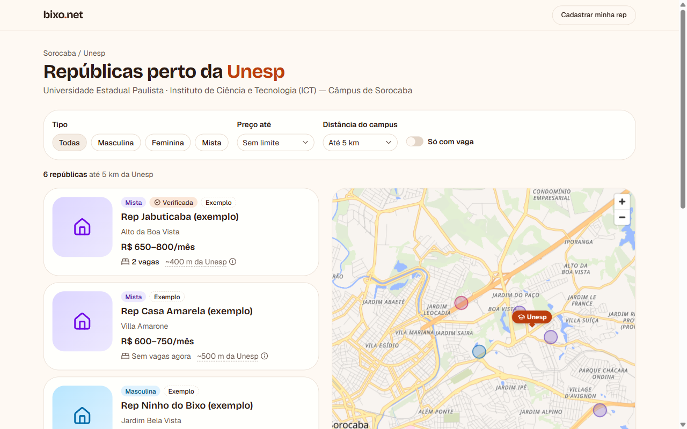
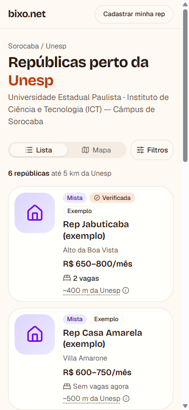
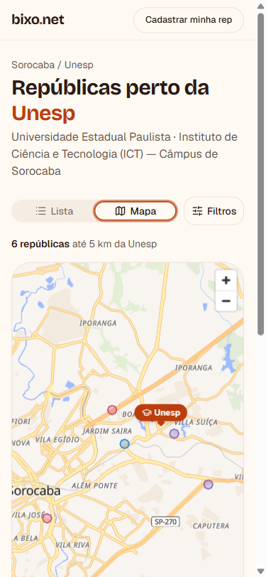
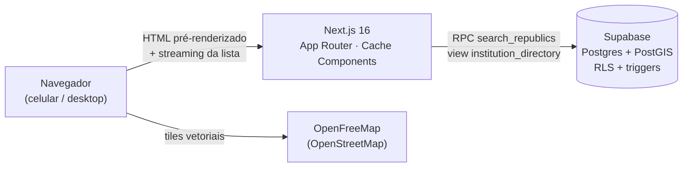

# bixo.net

**Ache república perto da faculdade.** O calouro escolhe a cidade e a faculdade e vê as repúblicas mais próximas do campus, numa lista e num mapa. Se não quiser república, encontra kitnets e os contatos de moradia da própria faculdade.

MVP em **Sorocaba (SP)**, com modelo de dados e URLs prontos para o estado de São Paulo.

[](https://github.com/DanielznRtm/Bixonet/actions/workflows/ci.yml)




## Por que existe

Todo ano, milhares de aprovados procuram moradia em poucas semanas, entre a lista de aprovados e a matrícula. A informação fica espalhada em grupos de WhatsApp e posts de Instagram, sem filtro e sem noção de distância. O bixo.net junta isso numa busca por **faculdade**, que é como o calouro pensa, e não por endereço.

## O que já funciona

- **Busca por faculdade** com autocomplete que entende sigla, nome e texto sem acento ("federal" encontra a UFSCar).
- **Lista ordenada pela distância** até o campus, calculada no banco com PostGIS.
- **Filtros na URL** (tipo, preço, só com vaga, raio): o link compartilhado no grupo abre já filtrado.
- **Mapa** com o campus e **áreas aproximadas** de ~150 m, nunca o endereço exato (LGPD).
- **"Não quero república":** kitnets e apartamentos perto do campus (links externos, sem scraping) e os contatos de moradia da própria faculdade, só quando confirmados no site oficial.
- **Mobile-first:** no celular, abas "Lista | Mapa" e filtros num painel; o mapa só é baixado quando aparece.
- **Segurança no banco:** RLS em todas as tabelas, leitura pública só por funções, localização arredondada por trigger e trava contra autoaprovação.

|                     Celular: busca                     |                    Celular: mapa                     |                    Celular: home                     |
| :----------------------------------------------------: | :--------------------------------------------------: | :--------------------------------------------------: |
|  |  |  |

> As repúblicas das imagens são **fictícias** (dados de exemplo, marcados como "Exemplo" na interface). As faculdades, coordenadas e contatos são reais e foram conferidos nos sites oficiais.

## Stack

| Camada    | Escolha                                                                 | Por quê                                                                                              |
| --------- | ----------------------------------------------------------------------- | ---------------------------------------------------------------------------------------------------- |
| Front-end | Next.js 16 (App Router, Cache Components), React 19, TypeScript estrito | Páginas pré-renderizadas para SEO e para abrir rápido no celular; streaming só do que depende da URL |
| UI        | Tailwind CSS 4, shadcn/ui (Radix), lucide-react                         | Componentes acessíveis (teclado, rótulos) com identidade própria                                     |
| Banco     | Supabase: Postgres + PostGIS, RLS                                       | Busca geográfica no próprio banco; regras de acesso testáveis                                        |
| Mapa      | MapLibre GL + OpenFreeMap (OpenStreetMap)                               | Tiles vetoriais sem chave e sem custo                                                                |
| Validação | Zod                                                                     | Filtros da URL validados campo a campo                                                               |
| Testes    | Vitest, pgTAP, Playwright                                               | Unidade, banco (RLS) e ponta a ponta em 375 px e 1280 px                                             |
| CI        | GitHub Actions                                                          | Lint, tipos, testes de unidade, banco, integração e E2E a cada push                                  |

## Arquitetura



- **Catálogo** (cidades e faculdades): em cache por horas, páginas geradas no build.
- **Busca:** roda dentro de `<Suspense>`, em cache por minutos para cada combinação de filtros, com tag para invalidar quando uma república for aprovada.
- **Distância:** `ST_Distance` sobre `geography`, calculada na hora (nada a sincronizar se um campus mudar de coordenada).

As decisões de arquitetura, com o problema, a escolha e o custo de cada uma, estão em **[docs/decisoes.md](docs/decisoes.md)**.

## Qualidade

| Tipo          | Ferramenta              | O que cobre                                                                                                                                  |
| ------------- | ----------------------- | -------------------------------------------------------------------------------------------------------------------------------------------- |
| Unidade       | Vitest                  | Filtros da URL, formatação, busca sem acento, geometria do círculo, link do WhatsApp, denúncia, planilha de imóveis, repetição em timeout    |
| Banco         | pgTAP (38 testes)       | O público não vê pendentes nem colunas privadas; o dono não se aprova; arredondamento; busca de repúblicas e imóveis; página de detalhe      |
| Integração    | Vitest + Supabase local | A busca chamada pelo Next devolve o esperado e a tabela fica fechada ao público                                                              |
| Ponta a ponta | Playwright (52 testes)  | Home → busca → república, moradia e imóveis, filtros, estados vazios, mapas, denúncia e 404, em 375 px e 1280 px, contra o build de produção |

## Rodando localmente

Pré-requisitos: Node.js 22+, Docker Desktop e Git.

```bash
npm install
npx playwright install chromium
cp .env.example .env.local
npm run db:start        # Supabase local (migrations + seed)
npx supabase status     # copie a URL e a publishable key para o .env.local
npm run dev             # http://localhost:3000
```

O Supabase Studio local fica em http://127.0.0.1:54323.

<details>
<summary>Todos os scripts</summary>

| Comando                                   | O que faz                                                                                    |
| ----------------------------------------- | -------------------------------------------------------------------------------------------- |
| `npm run dev`                             | Servidor de desenvolvimento                                                                  |
| `npm run build` / `npm start`             | Build de produção e servidor                                                                 |
| `npm run check`                           | lint + typecheck + testes de unidade                                                         |
| `npm run lint` / `npm run lint:fix`       | ESLint                                                                                       |
| `npm run typecheck`                       | Gera os tipos de rota do Next e roda o `tsc`                                                 |
| `npm run format` / `npm run format:check` | Prettier (ordena classes do Tailwind também)                                                 |
| `npm test` / `npm run test:watch`         | Testes de unidade (Vitest)                                                                   |
| `npm run test:db`                         | Testes do banco (pgTAP)                                                                      |
| `npm run test:integration`                | Busca chamada do Next contra o banco local                                                   |
| `npm run test:e2e`                        | E2E (Playwright) contra o build de produção, porta 3100                                      |
| `npm run db:start` / `npm run db:stop`    | Liga/desliga o Supabase local                                                                |
| `npm run db:reset`                        | Recria o banco local com migrations + seed                                                   |
| `npm run db:types`                        | Regenera `src/types/database.ts`                                                             |
| `npm run import:listings -- arquivo.csv`  | Importa imóveis de uma planilha (modelo em `docs/imoveis-modelo.csv`); `--dry-run` só valida |

</details>

<details>
<summary>Banco: migrations e admin</summary>

Toda mudança de schema é uma migration nova:

```bash
npx supabase migration new nome_da_mudanca
npm run db:reset
npm run db:types
```

O `seed.sql` só roda no banco local; os dados de exemplo nunca vão para produção.

Para virar admin (depois do primeiro login, na Fase 5), rode no SQL Editor do Studio:

```sql
insert into public.admins (user_id)
select id from auth.users where email = 'seu-email@exemplo.com';
```

</details>

## Estrutura

```
.github/workflows/    CI (GitHub Actions)
docs/                 decisões de arquitetura, setup e capturas de tela
e2e/                  testes Playwright
scripts/              utilitários de build (e, depois, importações de curadoria)
supabase/
  migrations/         única forma de mudar o schema
  tests/database/     testes pgTAP (RLS, triggers, busca)
  seed.sql            dados locais (faculdades reais, repúblicas fictícias)
src/
  app/                rotas (App Router)
  components/         UI: busca, mapa, card de república, layout, shadcn/ui
  lib/data/           acesso a dados com cache
  lib/search/         filtros, formatação e busca de texto (com testes)
  types/              tipos gerados do banco
```

## Roadmap

- [x] **Fase 0:** setup (Next.js, Tailwind, shadcn, testes, Supabase)
- [x] **Fase 1:** banco, RLS, busca geográfica, seed e testes pgTAP
- [x] **Fase 2:** home, busca por faculdade, filtros e mapa
- [x] **Fase 3:** página da república (galeria, regras, WhatsApp, denúncia)
- [x] **Fase 4:** "Não quero república": kitnets e contatos de moradia da faculdade
- [ ] **Fase 5:** cadastro com login por link mágico, upload de fotos e painel de moderação
- [ ] **Fase 6:** SEO, acessibilidade, Lighthouse ≥ 90 e deploy (Vercel + Supabase)
- [ ] **Fase 7:** busca em linguagem natural com a Claude API ("rep mista até 700 perto da Unesp")

## Como foi construído

Projeto desenvolvido por fases, com **Claude Code** como par de programação. O contexto, as regras e as skills do projeto ficam em [`CLAUDE.md`](CLAUDE.md) e [`.claude/skills/`](.claude/skills/). Cada fase começa com um plano aprovado, termina com lint, tipos, testes e verificação visual em 375 px e 1280 px, e as decisões ficam registradas em [docs/decisoes.md](docs/decisoes.md).

## English summary

**bixo.net** helps incoming university students in Brazil find shared student houses ("repúblicas") near their campus. Users pick a city and a university and get a distance-sorted list and a map. Built with Next.js 16 (App Router, Cache Components), TypeScript, Tailwind and shadcn/ui on top of Supabase (Postgres + PostGIS). Highlights: geographic search computed in the database, privacy by design (approximate ~150 m areas enforced by a database trigger, public reads only through `security definer` functions), 22 pgTAP tests for row-level security, and Playwright E2E tests on mobile and desktop running in CI against a production build.

---

Feito por [Daniel Macedo](https://github.com/DanielznRtm).
